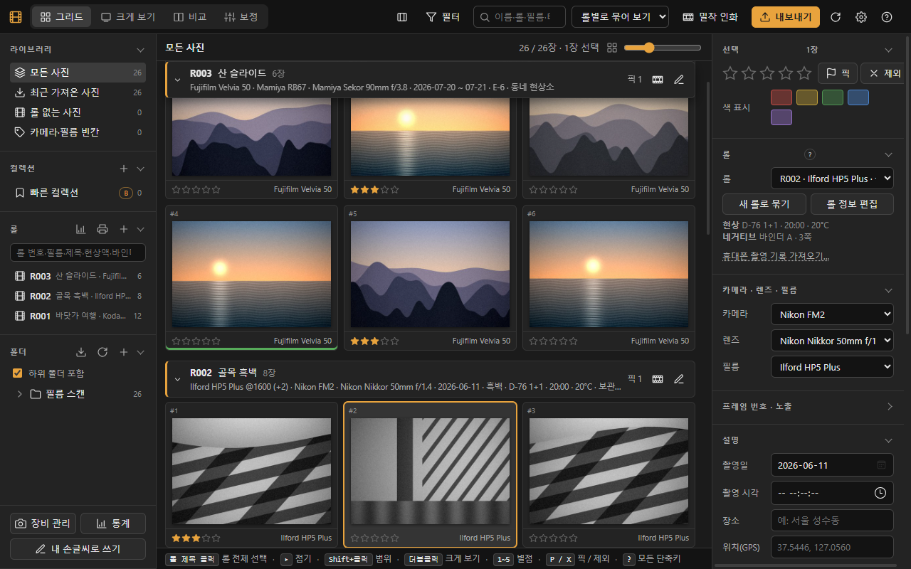
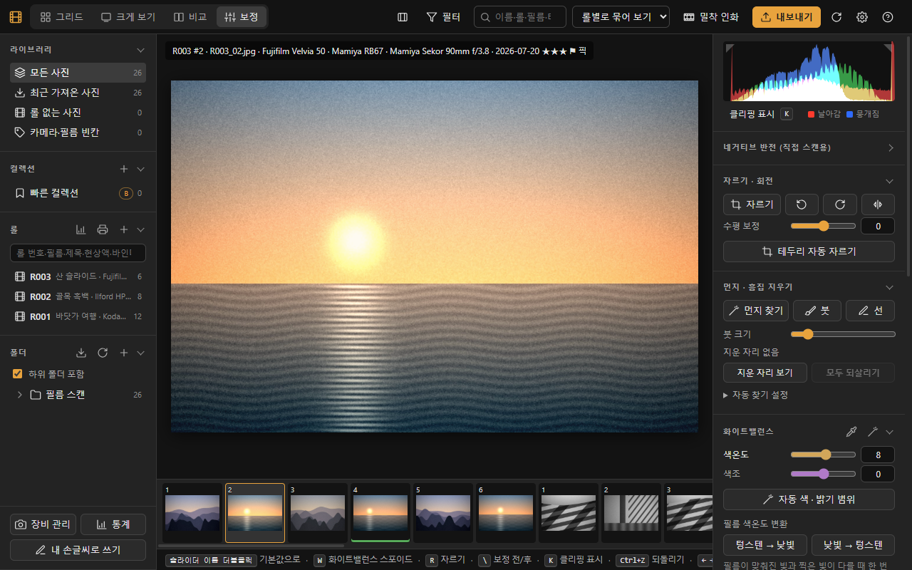
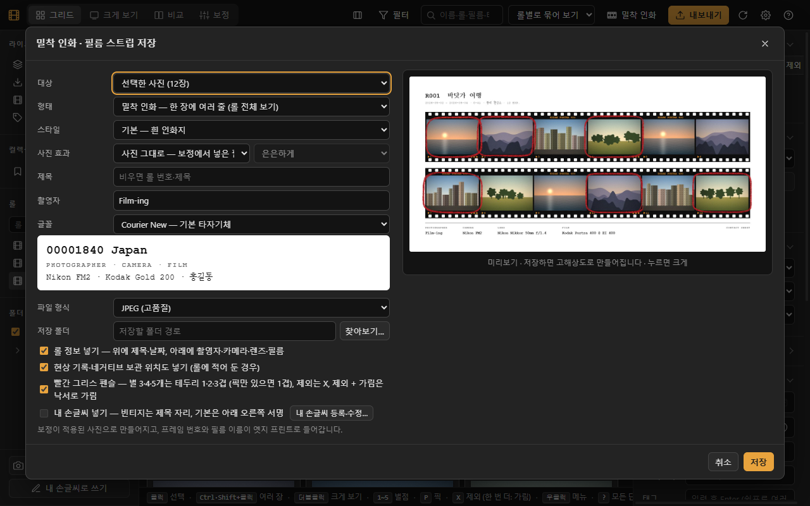
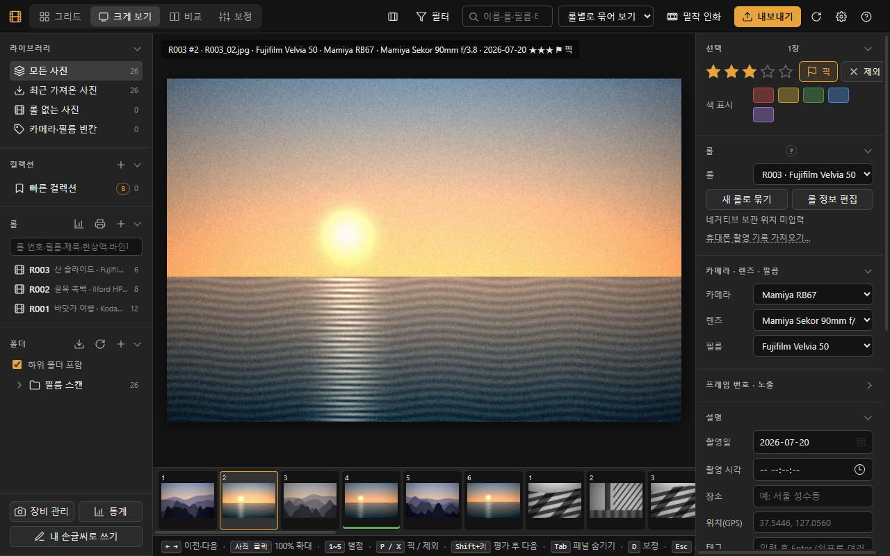

# Film-ing (필르밍)

**필름 사진가를 위한 윈도우용 사진 라이브러리.** 현상소에서 받은 스캔을 가져와 롤별로 정리하고, 고르고, 보정하고,
밀착 인화와 내보내기까지 한 곳에서 합니다. 모든 작업은 내 PC 안에서만 이루어지고, **원본 사진은 1바이트도 망가뜨리지 않는 것**을 가장 먼저 지킵니다.

> **English:** Film-ing is a free Windows photo library for film photographers — import lab scans, organize them by roll,
> cull, edit non-destructively, and print contact sheets. Everything stays on your PC; your original files are never damaged.
> Requires Windows 10/11 (64-bit) and Microsoft Edge. Download the installer from [Releases](../../releases/latest).



## 내려받기

**[최신 버전 내려받기 → Releases](../../releases/latest)** 에서 `Film-ing-Setup-<버전>.exe` 를 받아 실행하세요.

같은 페이지의 `filming-update-…zip`, `manifest.json`, `manifest.json.sig` 는 프로그램이 자동 업데이트에 쓰는 파일입니다. 직접 받을 필요는 없습니다.

## 무엇을 할 수 있나요

| | |
|---|---|
| **가져오기** | 스캔 폴더 추가, 현상소에서 받은 zip 바로 가져오기, 새로 저장된 사진 자동 가져오기, 옮기거나 이름이 바뀐 폴더 다시 찾기 |
| **롤 기록** | 롤 번호·카메라·렌즈·필름(자주 쓰는 필름 89종 내장)·감도(EI)·현상 방식·현상소, 현상 기록(현상액·희석·시간·온도), 네거티브 보관 위치, 현상소 맡김·비용, 엑셀·CSV 로 내보내기·가져오기, 촬영 기록의 위치(GPS)를 사진 파일에 기록 |
| **고르기** | 별점, 고름/제외(P/X), 색 표시, 여러 장 비교, 100%·200% 확대(휠로도), 한 장 이름 바로 바꾸기(`F2`), 별점·고름·정보·일괄 보정 되돌리기(`Ctrl+Z`) |
| **보정** | 원본은 그대로 두고 설정값만 저장(비파괴). 사진을 누르고 있는 동안 보정 전 보기, 좌우 나눠 보기(`Y`), 100% 확대(`Z`·`Space`·휠), 되돌리기·다시 하기(`Ctrl+Z`·`Ctrl+Y`), 앞 사진 보정 가져오기(`Ctrl+Alt+V`), 네거티브 반전, 화이트밸런스, 노출·대비·톤, 필름 효과 9가지, 자르기·수평, 테두리 자동 자르기, 자동 색, 먼지·흠집 지우기, 날아간 곳·뭉개진 곳 표시 |
| **출력** | 용도별 내보내기(원본 그대로·웹·인스타그램·16비트 TIFF·필름 테두리, 위치 정보 빼기), 내 내보내기 프리셋, 긴 작업 멈추기, 밀착 인화·필름 스트립, 네거 슬리브 라벨·롤 색인표 인쇄, 인스타그램 파노라마 나누기, 하프프레임 컷 나누기 |
| **보관** | 정리 기록(롤·별점·보정) 자동 백업(하루 한 번 + 중요한 작업 직전), 다른 드라이브에도 백업, 원하는 시점으로 되돌리기, 예전 라이브러리 가져오기 |
| **편하게** | 전체 화면(`F`), 다시 켜면 보던 폴더·롤·사진에서 이어 보기, 정렬 방향 바꾸기, 아래쪽 안내줄과 단축키 도움말(`?`) |

| 보정 | 밀착 인화 |
|---|---|
|  |  |



<sub>화면 그림 속 사진은 모두 시험용으로 만든 합성 그림입니다.</sub>

## 설치하기

1. [Releases](../../releases/latest) 에서 `Film-ing-Setup-<버전>.exe` 를 받습니다.
2. 받은 파일을 두 번 누릅니다. **관리자 권한이 필요 없고**, 내 사용자 폴더(`%LOCALAPPDATA%\Programs\Film-ing`)에 설치됩니다.
3. 바탕화면이나 시작 메뉴의 **Film-ing** 아이콘으로 켭니다. 처음 켜면 “사진 폴더 추가하기”부터 차례로 안내합니다.

설치 파일 하나에 프로그램이 돌아가는 데 필요한 것이 모두 들어 있습니다. 설치하면서 인터넷에서 따로 내려받는 것은 없습니다.

### “Windows의 PC 보호” 경고가 뜰 때

Film-ing 은 아직 코드 서명 인증서(게시자를 증명하는 유료 인증서)가 없어서, 처음 실행할 때 윈도우 SmartScreen 이
**“Windows의 PC 보호 — 인식할 수 없는 앱의 시작을 막았습니다”** 와 **게시자: 알 수 없는 게시자** 를 보여 줄 수 있습니다.

1. 경고 창의 **추가 정보** 를 누릅니다.
2. 앱 이름이 `Film-ing-Setup-<버전>.exe` 인지 확인하고 **실행** 을 누릅니다.

Edge 로 받을 때 “일반적으로 다운로드되지 않는 파일” 안내가 나오면, 내려받기 목록에서 `…` → **유지** → **자세히** → **그래도 유지** 를 누릅니다.

**받은 파일이 진짜인지 확인하려면** (선택): 릴리스 페이지의 `SHA256SUMS.txt` 에 적힌 값과 내 파일의 값을 비교합니다.

```powershell
Get-FileHash .\Film-ing-Setup-1.0.0.exe -Algorithm SHA256
```

두 값이 같으면 올린 그대로의 파일입니다. 다르면 실행하지 말고 다시 받아 주세요.

### 시스템 요구

- **윈도우 10 또는 11, 64비트**
- **Microsoft Edge** (윈도우에 기본으로 들어 있음 — 프로그램 창을 Edge 의 앱 창으로 엽니다. 주소창·탭 없는 전용 창이며, 평소 쓰는 Edge 설정과 섞이지 않습니다)
- 디스크: 프로그램 약 250MB + 정리 기록(미리보기·백업 포함, 사진 1000장에 수백 MB 정도)
- 인터넷은 필요 없습니다. 업데이트 확인과 의견 보내기, “지도에서 보기”를 쓸 때만 씁니다.

### 지우기

**설정 → 앱 → 설치된 앱** 에서 Film-ing 을 제거합니다. **사진 파일은 건드리지 않습니다.**
정리 기록(별점·보정·롤 기록·백업)은 기본으로 남기고, 지울지 한 번 물어봅니다. 남겨 두면 다시 설치했을 때 그대로 이어서 쓸 수 있습니다.

## 원본 보존 원칙

Film-ing 은 사진 파일을 가장 소중하게 다룹니다.

- **보정은 원본을 바꾸지 않습니다.** 설정값만 저장하고, 내보낼 때 새 파일로 만듭니다.
- 촬영 정보(롤·필름·별점 등)를 사진 파일에 적는 것은 **처음 한 번 물어보고**, 동의할 때만 합니다. 적을 때는 정보 구간만 바꾸고 **이미지 데이터는 바이트 단위로 그대로** 둡니다.
  저장 직후 원본과 비교해 정보 구간 밖이 1바이트라도 다르면 저장을 취소합니다.
- 처음 적기 전의 상태를 따로 보관해 두어, 언제든 **“기록 전 원본으로”** 를 누르면 처음 받은 파일과 똑같이 되돌립니다.
- 다른 프로그램이 쓰고 있는 파일, 읽기 전용 파일에는 쓰지 않습니다. 이름 바꾸기·옮기기는 도중에 꺼져도 다음 실행 때 복구합니다.
- 내보내기·밀착 인화 같은 긴 작업은 **멈추기** 로 멈출 수 있습니다. 하던 사진까지만 마치고 멈추므로 쓰다 만 파일이 남지 않습니다.
  창을 닫을 때 이런 작업이 남아 있으면 **멈추고 닫기 / 끝나면 닫기** 를 묻고, “끝나면 닫기”는 오래 걸려도 끝까지 한 뒤 꺼집니다.
- 지운 사진은 휴지통으로 갑니다. 휴지통이 없는 드라이브(USB·네트워크)에서는 지우지 않습니다.

## 자동 업데이트와 서명

- 처음 켤 때 **업데이트 알림** 을 받을지 묻습니다. “알림 받기”를 고르면 하루 한 번 새 버전이 있는지만 확인하고, 있으면 알려 드립니다. **받을지는 직접 고릅니다.**
  **설정 → 업데이트…** 에서 언제든 끄거나 “지금 확인” 할 수 있습니다.
- 받은 파일은 **전자 서명(Ed25519)** 과 파일마다의 내용 확인값(SHA-256)이 모두 맞을 때만 설치합니다. 누군가 릴리스 파일을 바꿔치기해도 서명이 맞지 않으면 설치하지 않습니다.
  서명 확인용 공개 키는 프로그램 안에 들어 있고, 서명용 개인 키는 이 저장소나 인터넷 어디에도 올리지 않습니다.
- 새 버전은 다음에 켤 때 바뀝니다. 새 버전이 제대로 켜지지 않으면 **이전 버전으로 자동으로 되돌립니다.**
- 업데이트는 프로그램 파일만 바꿉니다. **사진과 정리 기록은 바뀌지 않습니다.**
- 설치 파일 자체(`Film-ing-Setup-…exe`)에는 아직 코드 서명이 없어서 위의 SmartScreen 경고가 뜹니다. 자동 업데이트 파일은 위처럼 따로 서명되어 있습니다.

## 개인정보

**사진은 어디로도 보내지 않습니다.** 정리 기록(롤·별점·보정)도 내 PC(`%LOCALAPPDATA%\Film-ing`)에만 있습니다. 계정·광고·사용 통계 수집이 없습니다.
인터넷을 쓰는 것은 세 가지뿐입니다 — 업데이트 확인(동의한 경우), 의견 보내기(직접 보낼 때), 사진 위치를 지도에서 보기(직접 누를 때 브라우저로 OpenStreetMap 을 엶). 무엇이 오가는지는 **[PRIVACY.md](PRIVACY.md)** 에 자세히 적었습니다.

## 자주 쓰는 키

| 키 | 동작 |
|---|---|
| `G` / `E` / `C` / `D` | 그리드 / 크게 보기 / 비교 / 보정 |
| `1`~`5` · `P` / `X` | 별점 · 고름 / 제외 |
| `Ctrl+Z` / `Ctrl+Y` | 되돌리기 / 다시 하기 (다시 하기는 보정 화면) |
| 사진 누르고 있기 · `Y` | 보정 화면: 누르는 동안 보정 전 · 좌우 나눠 보기 |
| `Z` · `Space` · 휠 | 확대 (크게 보기: 맞춤 → 100% → 200%) |
| `F` | 전체 화면 |
| `F2` | 이름 바꾸기 (한 장이면 그 자리에서) |
| `?` | 모든 단축키 |

## 의견 보내기

불편한 점이나 바라는 기능은 프로그램 안에서 보내 주세요: 도움말(`?`) 창 또는 설정 창의 **의견 보내기…**.
보내기 전에 나갈 내용을 그대로 확인할 수 있고, 인터넷이 끊겨 있으면 보관했다가 나중에 보냅니다.
메일로 보내셔도 됩니다: filmingapp.official@gmail.com

## 바뀐 내용

버전마다 바뀐 내용은 [CHANGELOG.md](CHANGELOG.md) 와 [Releases](../../releases) 에 있습니다.

## 라이선스 · 출처

- Film-ing 은 무료로 내려받아 쓸 수 있습니다. 프로그램의 원본 코드는 이 저장소에 없습니다 — 이 저장소에는 설치 파일과 업데이트 파일, 안내 문서만 올립니다.
- 함께 들어 있는 구성 요소와 라이선스(설치 폴더의 `THIRD_PARTY_NOTICES.txt` 에 전문):
  - Python (Python Software Foundation License) — 함께 든 OpenSSL·SQLite·zlib·libffi·Tcl/Tk 조건 포함
  - Flask · Werkzeug · Jinja2 · ItsDangerous · Click · MarkupSafe (BSD-3-Clause), Blinker (MIT), colorama (BSD-3-Clause)
  - Pillow (MIT-CMU), NumPy (BSD-3-Clause 외), piexif (MIT), tifffile (BSD-3-Clause), imagecodecs (BSD-3-Clause),
    OpenCV (`opencv-python-headless`, Apache-2.0), defusedxml (PSF License)
  - 글꼴: Courier Prime · Cutive Mono · East Sea Dokdo(동해 독도) · Jost (SIL Open Font License 1.1), Homemade Apple (Apache-2.0)
- 일부 기능의 아이디어는 **Grainy** (pastorius9, MIT License) 에서 얻었습니다 — 창이 뒤에 있어도 느려지지 않게 하기, 클리핑 표시, 지난 설정으로 내보내기,
  흑백 저장·디더링, 테두리 자동 자르기, 자동 색, 필름 색온도 변환, 새 사진 자동 가져오기, 바뀐 폴더 찾기, 백업 검사, 먼지·흠집 찾기.
  코드는 가져오지 않고 Film-ing 구조에 맞게 새로 작성했습니다.
